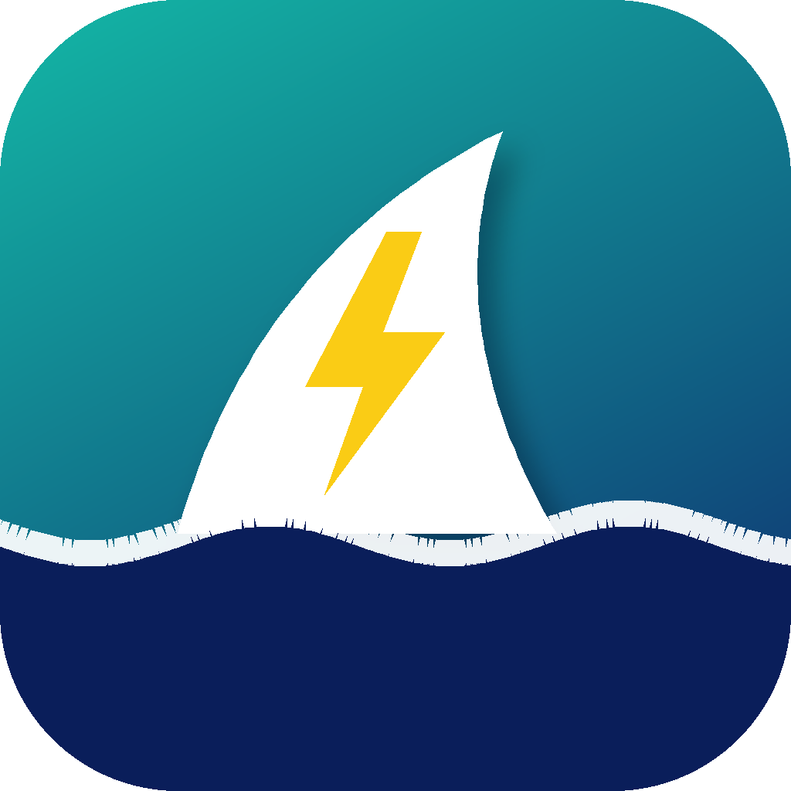
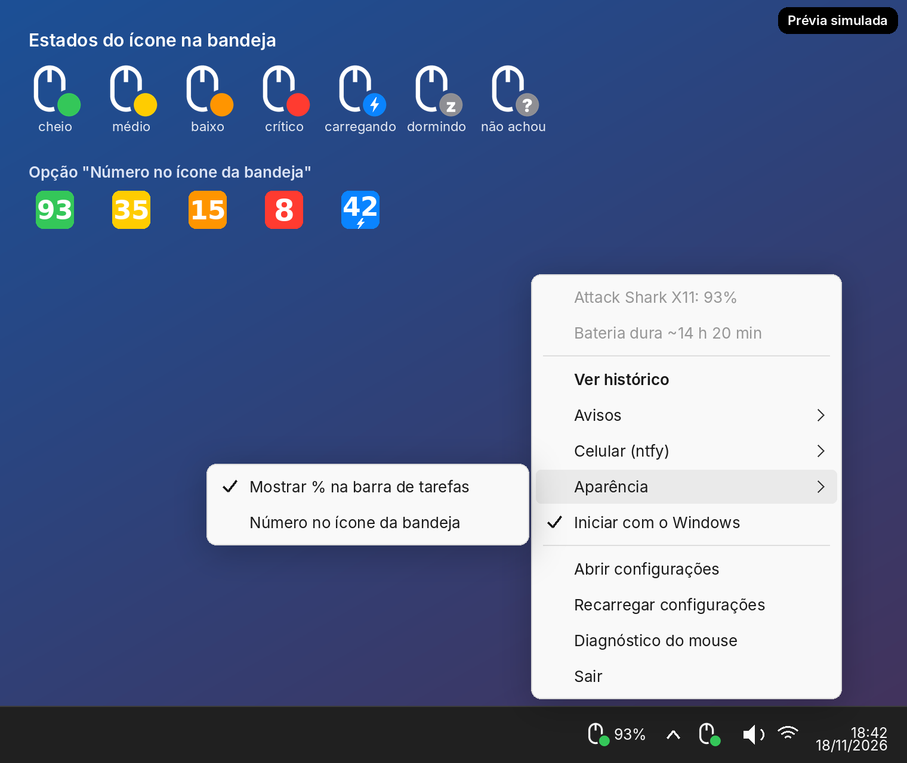
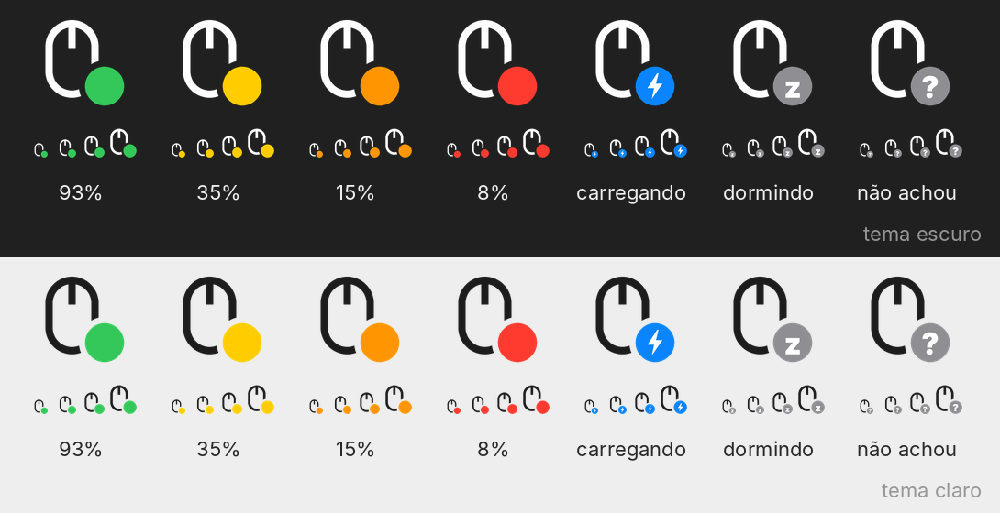

# 🦈 SharkInfo

App de bandeja do Windows que mostra a bateria do seu mouse **Attack Shark** ao lado do relógio e avisa **antes** de ele morrer no meio da partida.

Feito em C++ puro com a API do Windows. Não usa nenhuma biblioteca externa: o `.exe` tem **~380 KB**, não precisa instalar nada e só usa DLLs que já vêm no Windows (hid, setupapi, gdiplus, winhttp…).



## Como usar

1. Baixe o `SharkInfo.exe` da [última release](https://github.com/Pedr030/sharkinfo/releases/latest) e coloque numa pasta fixa, por exemplo `C:\Programas\SharkInfo\`. Evite `Arquivos de Programas`, porque o atualizador precisa conseguir trocar o arquivo.
2. Dê dois cliques nele. O ícone aparece na bandeja. Se ele cair na setinha `^`, arraste-o para perto do relógio.
3. Clique com o botão direito no ícone e marque **"Iniciar com o Windows"**.

> **Aviso do Windows SmartScreen:** como o `.exe` não tem assinatura digital paga, o Windows pode mostrar "O Windows protegeu o computador". Clique em **Mais informações → Executar assim mesmo**. Se preferir, compile você mesmo (instruções abaixo).

Para testar sem esperar a bateria acabar, abra um Prompt de Comando na pasta e rode:

```
SharkInfo.exe --demo
```

O mouse simulado descarrega, passa pelos avisos de 20% e 10%, vai para o cabo e enche, tudo em ~2 minutos.

## Atualizações

O SharkInfo se atualiza sozinho pelas [releases do GitHub](https://github.com/Pedr030/sharkinfo/releases), do mesmo jeito que o app Sinal:

1. Ele procura versões novas 10 segundos depois de abrir e depois a cada 30 minutos.
2. Quando acha uma, baixa em segundo plano e confere a **impressão digital (SHA-256)** do arquivo com a que a release publicou. Se o arquivo vier corrompido ou alterado, ele é descartado.
3. Avisa com uma notificação, **mas nunca enquanto você está jogando em tela cheia**. Nesse caso, espera você sair do jogo.
4. Clicando na notificação, aparecem as novidades e duas opções: **Reiniciar agora** (leva 1 segundo) ou **Depois**, que instala sozinho quando o SharkInfo for fechado.

No menu → **Atualizações** dá para procurar na hora ou desligar a atualização automática.

## O que ele faz

| Função | Como aparece |
|---|---|
| % na barra de tarefas | Ao lado do relógio: símbolo de mouse + "93%" (pode desligar em **Aparência**) |
| Ícone na bandeja | Mouse com um **selo** colorido no canto: verde > 50%, amarelo, laranja, vermelho ≤ 10%, azul com raio carregando, cinza com "z" dormindo e "?" quando não acha o mouse |
| Avisos em 20% e 10% | Notificação do Windows + faixa por cima do jogo + celular (opcional) |
| Tempo restante | "Bateria dura ~6 h 10 min", pela velocidade com que a bateria vem caindo |
| Tempo para carregar | "Cheio em ~45 min" enquanto está no cabo |
| Carga completa | "Mouse em 100%, pode tirar do cabo" |
| Histórico | Clique esquerdo no ícone: gráfico de 24 h ou 7 dias, com os períodos no cabo em azul |

**Faixa por cima do jogo:** funciona com o jogo em **janela sem bordas**. Ela não rouba o foco e o clique atravessa ela. Em **tela cheia exclusiva**, o Windows não deixa nada aparecer por cima; aí valem a notificação e o celular. Para conferir, abra o jogo e use **Avisos → Testar faixa na tela**.

## Aparência

No menu do ícone, em **Aparência**, há duas opções:

- **Mostrar % na barra de tarefas** (ligada por padrão). Coloca o mouse com selo e a % escrita ao lado do relógio, como no print do krisgfx. O Windows não tem um jeito oficial de colocar texto na barra, então o app encaixa uma janelinha dentro dela. Se uma atualização do Windows mudar a barra e o encaixe falhar, você continua com o ícone normal da bandeja.
- **Número no ícone da bandeja.** Troca o mouse com selo do ícone da bandeja por um quadradinho colorido com o número.



## Como funcionam as estimativas

- **Filtro anti pula-pula:** a bateria "se recupera" um pouco quando o mouse descansa, e o número pode ir e voltar (80 → 90 → 80), principalmente em modelos que medem de 10 em 10%, como o X6/R1. Para descer, a maioria das leituras dos últimos 3 minutos precisa concordar. Para subir fora do cabo, o valor mais alto precisa se manter por 10 minutos.
- **Bateria restante:** o app anota os "marcos de queda", que são os momentos em que a bateria chega a um valor mais baixo do que já tinha chegado. O tempo entre o primeiro e o último marco dá a velocidade de descarga. Enquanto a sessão atual ainda não tem dois marcos, ele usa a velocidade aprendida nos dias anteriores. Na primeira vez de todas, usa `horas_bateria_padrao` e mostra "(estimativa inicial)". A conta considera só o tempo de uso: PC desligado ou mouse dormindo separam as sessões.
- **Tempo de carga:** no cabo, o mouse Attack Shark **não informa a %**. Ele só avisa "carregando" e depois "cheio". Então o app anota com quantos % você plugou e quanto tempo levou até encher, e aprende a velocidade real de carga (mediana das últimas 5 cargas). Até a primeira carga completa, usa o padrão de 120 min de 0 a 100% e mostra "(aprendendo)".

## Celular (opcional)

1. Instale o app gratuito **ntfy** no celular.
2. No PC, abra **Celular (ntfy) → Copiar tópico**.
3. No ntfy, toque em **+** e cole o tópico.
4. No PC, marque **"Enviar avisos pro celular"** e use **"Enviar teste"** para conferir.

## Configurações

Menu → **Abrir configurações** abre o `config.ini` no Bloco de Notas. Edite, salve e clique em **Recarregar configurações**. O arquivo fica em `%APPDATA%\SharkInfo\`, junto com o histórico (`leituras.csv` e `cargas.csv`).

| Chave | Padrão | O que faz |
|---|---|---|
| `aviso_percentual` | 20 | Primeiro aviso |
| `critico_percentual` | 10 | Aviso urgente |
| `intervalo_segundos` | 10 | De quanto em quanto tempo atualiza |
| `segundos_aviso_na_tela` | 6 | Quanto tempo a faixa fica visível |
| `posicao_aviso` | topo | `topo` ou `base` |
| `minutos_carga_padrao` | 120 | Tempo de carga completa até o app aprender o real |
| `horas_bateria_padrao` | 60 | Quantas horas de uso a bateria cheia dura, até o app aprender o real |
| `forcar_escala_dezenas` | -1 | `1` se aparecer 7% quando o certo é 70%; `0` no caso contrário |
| `widget_barra` | 1 | `0` desliga a % na barra de tarefas |
| `icone_numero` | 0 | `1` mostra o número no ícone da bandeja |
| `atualizar_automaticamente` | 1 | `0` desliga a procura automática por versões novas |

## Mouse não detectado?

Menu → **Diagnóstico do mouse**, ou rode `SharkInfo.exe --diagnostico`. Isso gera um `diagnostico.txt` com tudo o que o app vê no USB e as mensagens cruas do receptor.

**Modelos suportados:**
- **Receptor Xenta (VID 1D57):** X11, X11 SE/Pro, X6, R1, X3, X3 Max/Pro, V3 Pro e V6. O receptor transmite a bateria sozinho a cada ~2 s.
- **Receptor Rongyuan:** R3 e outros. Esses só respondem se o app perguntar.

## Compilar você mesmo

**Visual Studio 2022** (com "Desenvolvimento para desktop com C++"): *Arquivo → Abrir → Pasta* e escolha esta pasta. O VS detecta o `CMakeLists.txt` sozinho. Depois é só escolher a configuração **Release** e mandar compilar.

**MSYS2/MinGW ou Linux:** rode `./build-mingw.sh`. O resultado sai em `build/SharkInfo.exe`, junto com `build/testes.exe`, que são os testes automáticos.

Compilado à mão, o app fica na versão `0.0.0-dev`, e nela o atualizador fica desligado.

## Publicar uma versão nova

O GitHub Actions faz quase tudo:

1. Escreva as novidades no `CHANGELOG.md`, numa seção `## vX.Y.Z`. Esse texto vira as notas da release e aparece na janela de atualização do app.
2. Faça o commit e envie para a `main`. O workflow **CI** compila e roda os testes num Windows de verdade.
3. Crie e envie a tag:
   ```
   git tag v1.1.0
   git push origin v1.1.0
   ```
4. O workflow **Release** compila com essa versão, roda os testes de novo, gera o `SharkInfo.exe.sha256` e publica a release. Em poucos minutos, quem usa o SharkInfo recebe a atualização.

## Mapa do código (`src/`)

| Arquivo | Papel |
|---|---|
| `main.cpp` | O maestro: ícone, menu, laço de mensagens e thread de leitura |
| `leitores.cpp` | Lista os dispositivos HID e fala com os receptores Xenta e Rongyuan (e o demo) |
| `historico.cpp` | Arquivos .csv e os cálculos de tempo restante e de carga |
| `avisos.cpp` | Faixa por cima do jogo, envio pro ntfy e o "porteiro" dos avisos |
| `icone.cpp` | Desenha o ícone (mouse com selo, ou o número) com GDI+ |
| `widget.cpp` | O "🖱 93%" encaixado na barra de tarefas |
| `atualizador.cpp` | Atualização automática pelo GitHub Releases |
| `suavizador.h` | Filtro que impede a % de ficar pulando |
| `versao.h` | A versão do app (o build da release preenche) |
| `grafico.cpp` | Janela do histórico, desenhada à mão com GDI+ |
| `config.cpp` | Lê e grava o config.ini |
| `sistema.cpp` | Iniciar com o Windows e impedir que o app abra duas vezes |
| `comum.h` | Peças compartilhadas: a ficha `Leitura`, a trava para threads e funções de tempo |

## Créditos do protocolo

- [krisgfx9/Wireless-Device-Battery-Monitor](https://github.com/krisgfx9/Wireless-Device-Battery-Monitor): códigos de modelo Xenta e receptores Rongyuan
- [KaiSta/attackSharkOnLinux](https://github.com/KaiSta/attackSharkOnLinux): relatório 0x03 do X11
- [incconutwo/mouse-battery-tray](https://github.com/incconutwo/mouse-battery-tray): PIDs e modelos
- [qu1ncky/BatteryTray](https://github.com/qu1ncky/BatteryTray): o truque das duas leituras iguais e o comando Rongyuan
